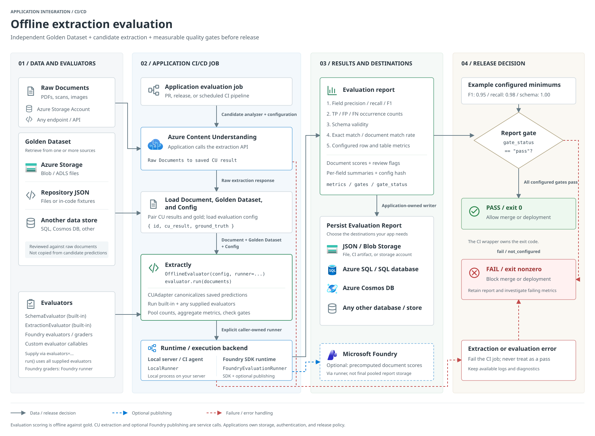
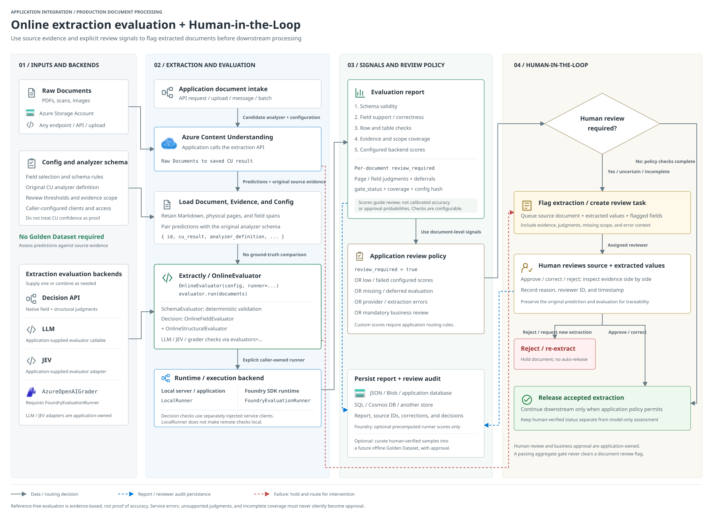

[README](README.md) | [User guide](docs/guide.md) |
[Project structure](Project-Structure.md)

## Application integration

### Offline evaluation in CI/CD

Compare candidate extractions with an independent Golden Dataset, persist the
evaluation report, and use configured thresholds to gate merge or deployment.



[Open the full-size offline diagram](docs/assets/offline-cicd-architecture.svg)

### Online evaluation with Human-in-the-Loop

Assess extracted values against source evidence without a Golden Dataset.
Application-owned review policy routes flagged documents to human approval,
correction, or rejection and retains the evaluation and review audit trail.



[Open the full-size online diagram](docs/assets/online-hitl-architecture.svg)

## Evaluation flow

```text
OfflineEvaluator                         OnlineEvaluator
Saved CU + independent gold               Saved CU + analyzer / evidence
             |                                         |
OfflineEvaluationConfig                   OnlineEvaluationConfig
             |                                         |
CUAdapter + SchemaEvaluator                CUAdapter + SchemaEvaluator
             |                                         |
ExtractionEvaluator                       Optional Decision checks:
Optional text F1                           fields + page structure
             |                                         |
             +--- Explicit EvaluationRunner -----------+
                  LocalRunner / FoundryEvaluationRunner
                                    |
                     Coverage validation + aggregation
                                    |
                      Gates + configuration fingerprint
                                    |
                       Report returned to the caller
```

Decision service requests run in the online workflow before its schema and
custom-evaluator runner job. They use the injected Decision client, not the
runner's optional Foundry publishing client. Selecting `LocalRunner` therefore
does not make injected semantic checks local.

## Responsibilities

| Component | Owned responsibility |
| --- | --- |
| [Comparison models](src/extractly/comparison.py) | Compile field selection, Pydantic validation, and registered boolean comparison rules |
| [Configuration](src/extractly/config.py) | Validate shared table paths, context budgets, and minimum-score policy |
| [CU parsing](src/extractly/cu/cu_result_parser.py) | Unwrap typed fields while retaining segment occurrences and evidence |
| [Adapter](src/extractly/cu/adapter.py) | Prepare canonical response, Markdown, confidence, and span metadata |
| [Ground-truth helper](src/extractly/cu/ground_truth.py) | Build editable annotation drafts without treating them as independent gold |
| [Page preparation](src/extractly/cu/_pages.py) | Assign physical-page evidence and defer uncertain provenance |
| [Evaluators](src/extractly/evaluators/__init__.py) | Schema validation, positional gold comparison, or focused Decision judgments |
| [Offline workflow](src/extractly/offline.py) | Require gold, prepare datasets, validate extraction counts, and pool occurrence metrics |
| [Online workflow](src/extractly/online.py) | Prepare reference-free inputs, execute injected Decision checks, and retain page progress |
| [Runner interfaces](src/extractly/eval_runner/base.py) | Execute typed requests and return rows, metrics, and optional provider metadata |
| [Shared mechanics](src/extractly/_shared.py) | Serialize temporary datasets, dispatch runners, validate coverage, and build compact reports |

Neither workflow imports, delegates to, or branches into the other. Their public
methods do not accept mode flags; supplying or omitting gold cannot switch
behavior. Offline single-document evaluation requires gold, and the online
single-document signature does not accept it. Online batch gold is ignored
and never serialized into evaluator datasets.

Offline configuration adds optional text-overlap diagnostics. Online
configuration adds field budgets, selected original paths, document-level
fields, and record selection. Semantic model settings belong to supplied
clients, not hidden workflow configuration.

## Execution and publishing

Both workflows require an explicit `runner=`; neither chooses a fallback.
Runners subclass `EvaluationRunner` and consume `RunnerRequest` datasets
before returning `RunnerResult`. Shared validation checks exact document ID
coverage and required outputs regardless of the backend.

* `LocalRunner` invokes synchronous callables sequentially and averages numeric
  outputs. It performs no authentication or publishing, rejects grader objects,
  and does not prevent supplied callables from making remote requests.
* `FoundryEvaluationRunner` delegates execution to
  `azure.ai.evaluation.evaluate`. `config.project` optionally selects classic
  publishing through that SDK.
* A caller-owned `openai.OpenAI` client on `FoundryEvaluationRunner` additionally
  submits precomputed per-document scores to new Foundry evaluations. It does
  not rescore in the cloud. Submitted records contain IDs and scalar outputs,
  not source inputs or detailed evaluator diagnostics.

New Foundry grading criteria require a finite numeric score in `[0, 1]` for
every row; occurrence and violation counts are diagnostics. Review flags and
Decision metrics appended after runner execution are not part of that runner's
published scores. Portal document-score averages are not pooled field F1.

Standalone runner metadata can retain publishing IDs and URLs. Workflow
reports intentionally omit native runner metadata and raw SDK rows. See
[the runner guide](docs/guide.md#execution-runners) for configuration and limits.

## Ownership and failure contracts

Library callers configure authentication, provider policies, custom evaluators,
and required execution runner instances. The library never closes caller-owned
dependencies, commits transactions, creates cloud resources, or reads an
application's local settings.

Applications own source loading, error handling, report storage, and approval
policies. There is no command-line entry point or automatic environment-file
loading. Custom checks cannot replace reserved built-in evaluators.

Temporary JSONL inputs contain sensitive document evidence and are removed at
the end of the evaluation context, including on exceptions. This is filesystem
cleanup, not a secure-erasure guarantee. Native SDK behavior may create its own
telemetry or artifacts. Report retention belongs to the caller.

Failed or incomplete provider output raises rather than producing success-shaped
partial averages. Provider exceptions propagate unchanged. Decision batches
prepare all page requests before inference; after failure, `page_results`
retains completed, failed, and unattempted page states, while
`request_previews` retains prepared batch requests. No successful workflow
report is fabricated after a failed page.

## Comparison and report semantics

Arrays compare at matching positional indices, without keyed alignment.
Duplicate occurrences remain distinct. A default `TableRule` counts the
selected list as a table and its elements as rows; empty lists retain a table,
while missing lists do not. Field-value comparison is independent of row/table
presence, identity, and association checks.

Comparators return one boolean. Accepted variation is a normal match in every
score, including exact match. Invalid gold raises; invalid predictions count
as errors. Defaults never manufacture observed values.

Pooled field scores use summed TP/FP/FN occurrences. Mean-document scores
average defined per-document scores. Undefined positive ratios remain null.
Offline run-level exact match requires every document to match; the document
exact-match rate instead reports the matching fraction. See
[metric definitions](docs/guide.md#reports-and-metrics).

Base reports contain run metrics, per-document scores and review flags,
per-field summaries, gates, mode, document count, and a configuration hash.
They exclude raw inputs and job results. Decision reports additionally retain
detailed page judgments and coverage, so they can contain source values.
Multi-page evidence does not establish a document-wide field score or unique
table count. Resolved page row counts can pool only with complete row coverage.

Review flags are document-specific and independent of run-level gates.
Base gates fail on missing or undefined scores and use unrounded values before
report rounding. Decision gates allow `incomplete` for unresolved metrics and
reject unknown metric names. Neither gate status nor model probability is an
automatic release or business approval.

## Deliberate boundaries

No document ingestion, persistence framework, retry engine, review workflow,
probability calibration, or business-specific validation is included. Semantic
grading and publishing are opt-in service operations. Neither evaluates the
correctness of the original OCR independently.

See [the user guide](docs/guide.md) for executable examples and
[contributing](CONTRIBUTING.md) for development checks.
