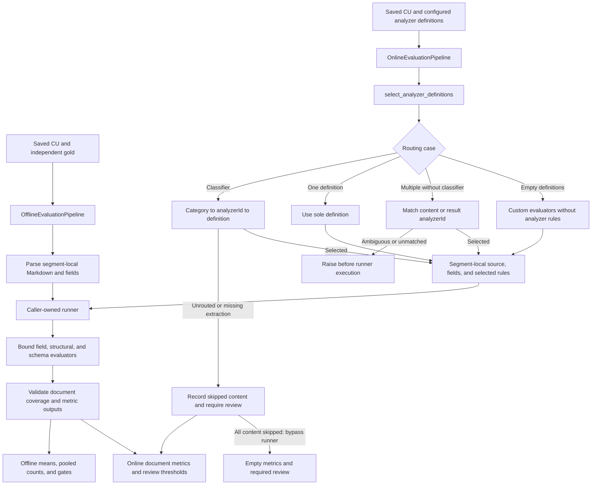

[README](README.md) | [User guide](docs/guide.md) |
[Project structure](Project-Structure.md)

## Evaluation flow

An explicit evaluator mapping replaces defaults. Offline calls require gold;
online calls never forward gold. Clients and deployments configure online
defaults without hidden authentication or client construction.

## Responsibilities

| Component | Responsibility |
| --- | --- |
| [Comparison models](src/extractly/comparison.py) | Typed fields and registered static comparison policies |
| [CU parser](src/extractly/cu/cu_result_parser.py) | Single conversion path for typed segments, local Markdown, and normalized fields |
| [Analyzer selector](src/extractly/cu/analyzer_selector.py) | Per-content classifier or ID routing, with explicit skipped-content outcomes |
| [Field evaluator](src/extractly/evaluators/field.py) | Reference-based validation, comparisons, and field metrics |
| [Structural evaluator](src/extractly/evaluators/structural.py) | Model-derived table and positional row presence |
| [LLM field evaluator](src/extractly/evaluators/llm_field.py) | Source-grounded field judgments |
| [LLM structural evaluator](src/extractly/evaluators/llm_structural.py) | Source counts and structural integrity judgments |
| [Schema evaluator](src/extractly/evaluators/schema.py) | Stateless normalized-value validation |
| [Offline pipeline](src/extractly/offline_pipeline.py) | Reference-based defaults and batch entry point |
| [Online pipeline](src/extractly/online_pipeline.py) | Caller-configured LLM defaults and single-document reference-free entry point |
| [Pipeline mechanics](src/extractly/_pipeline.py) | Dispatch, preparation, execution, coverage, and separate offline aggregation and online review reports |
| [Runners](src/extractly/eval_runner/base.py) | Typed execution boundary and optional publishing |
| [Golden-dataset stores](src/extractly/store/base.py) | Independent ground-truth loading keyed by document ID |

Evaluators do not accept pipeline configuration. Required model and evidence
inputs are call parameters. CU parsing is available independently of either
pipeline.

The CU parser returns `ParsedCUResult.segments` as an ordered list of frozen
`ParsedCUSegment` dataclasses. Each carries source identity, pages, local
Markdown, and normalized fields. Confidence, geometry, and span evidence are
not collected. Pipelines serialize the canonical segment envelope and preserve
field pointers. Binding uses each segment's Markdown rather than the combined
document context. Offline ground truth remains independently supplied.

Online configuration supplies an analyzer-definition array. The selector checks
for one classifier before considering single-definition or explicit-ID matching.
Each selected segment carries its own rules into the evaluator binding; the
standalone LLM contracts still accept one definition. Unrouted content is
excluded from scoring and reported in `skipped_contents`, forcing review.
When every content item is skipped, the pipeline bypasses the runner and returns
empty metrics with required review.

`run_pipeline` dispatches to `run_offline_pipeline` or `run_online_pipeline`.
The offline path validates and forwards ground truth; the online path excludes
it and rejects batch inputs. Both reuse parsing, runner execution, result
validation, fingerprinting, and rounding helpers. Offline `_build_report`
retains aggregation and gates. A separate `_build_online_report` uses the
single document's row metrics without calling the offline report builder.

`GoldenDatasetStore.load(prefix)` is a separate persistence boundary.
`AzureBlobGoldenDatasetStore` reads one JSON annotation per document beneath
a directory prefix using a caller-owned synchronous container client.
Callers join the returned ground truth to saved CU responses before invoking
the offline pipeline. Stores do not create clients, derive gold from
predictions, or perform evaluation.

## Aggregation contract

Each evaluator returns a nonempty `metrics` dictionary of finite scalar scores
or unknown values. Diagnostics are excluded from compact reports. Both
document and run metrics are grouped by evaluator name.

Offline document means retain defined-value averaging. Complete occurrence groups
also produce pooled ratios from summed TP/FP/FN. Missing occurrence evidence
cannot become a perfect pooled score. Thresholds use unrounded values;
rounded report copies do not modify runner results.

Online reports contain one document ID, direct namespaced metrics, and a
`review_required` flag instead of document lists, batch means, pooled scores,
or gates. Review combines document signals with configured document-metric
threshold failures, including missing or undefined scores. Multiple canonical
segments within the same document retain segment-local evaluation and
document-level occurrence counts and ratios.

Field comparison and structural presence are independent. Whole-list
comparators cannot hide extra rows from structural metrics. Matching counts
do not establish row identity or scalar correctness.

## Ownership and failures

Callers own authentication, clients, retries, timeouts, execution runners,
source loading, report storage, and approval policies. The package does not
close caller-owned clients or choose a fallback runner.

Provider exceptions propagate unchanged. Every document identity must appear
exactly once in runner results, and every selected evaluator must supply
usable metrics. Temporary input files are cleaned up on success and failure;
this is not secure erasure.

`LocalRunner` does not publish or authenticate, but supplied evaluators can
make remote calls. `FoundryEvaluationRunner` retains SDK execution and optional
publishing. Compact reports exclude native runner rows and metadata.

## Client APIs

CU parsing, per-content analyzer selection, and custom static comparison
registration are supported independently. The CU package contains the parser
and analyzer selector modules and their exports. Adapter preparation,
ground-truth draft generation, and obsolete analyzer/page helpers remain
removed, along with the combined extraction and Decision evaluators.